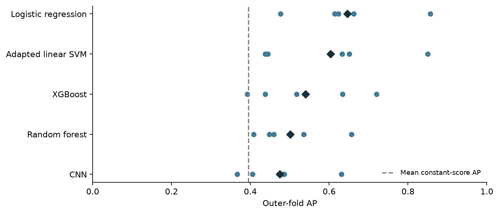

# ECG sleep apnea classification

A reproducible comparison of RR interval features, classical classifiers, an adapted literature SVM, and a lightweight 100 Hz CNN on the PhysioNet Apnea-ECG learning cohort.

**Start with the [final report](docs/final-study-report.md), [PDF](reports/final-study-report.pdf), or [illustrated HTML](reports/final-study-report.html).** [START_HERE.ipynb](notebooks/START_HERE.ipynb) verifies the included data and models, summarizes the results, and demonstrates inference from a saved logistic regression model without training.

## Findings

- **RQ1:** adding SDRR, RMSSD and pRR50 improved mean outer-fold average precision (AP) over basic interval/heart-rate summaries. SDRR had the largest conditional removal effect; pRR50 showed little incremental value here.
- **RQ2:** logistic regression led the tested pipelines (mean fold AP **0.646**), followed by the adapted literature SVM (**0.603**), XGBoost (**0.540**), random forest (**0.502**) and CNN (**0.474**). The constant-score reference was **0.395**.
- Model ranking did not translate into reliable operating points. At their inner-selected thresholds, all primary models had pooled specificity below 0.41. The CNN called every held-out minute positive in two folds.
- Follow-up audits reproduced saved inputs, predictions, filtering and stopping decisions. Seventeen low-signal minutes were constant in the source recordings; selected CNN histories showed unstable stopping-group generalization.



This is retrospective exploratory research, not a clinical diagnostic system. Subject identities remain unverified, the cohort had prior exposure, and there is no independent external validation. The report distinguishes observed rankings from supported uncertainty claims.

## What is included

| Resource | Contents |
| --- | --- |
| `docs/` | Final report, detailed findings and scientific method/audit documentation |
| `reports/` | PDF and HTML report, five main figures and diagnostic CSVs/figures |
| `notebooks/` | Reproducible notebook sources; exact frozen definitions are preserved |
| `notebooks/executed/` | Executed evidence snapshots, including a verified START_HERE and curated audits; local display paths redacted |
| `data/raw/apnea-ecg-1.0.0/` | The 34 analyzed ECG recordings, headers, A/N annotations, provider checksums and attribution |
| `data/processed/` | Cohort, quality flags, RR intervals/peaks, features, grouped assignments, frozen searches, and all reported prediction/metric tables |
| Primary models | 25 outer-fold model files: five tuned pipelines × five outer folds, seed 67 |
| `provenance/` | Original full export manifest, explicit bundle curation record, checksums and model documentation |
| Optional release asset | Exact prepared waveform arrays for signal audits, available under the `study-artifacts-v1` release |

The repository omits candidate checkpoints, aggregate checkpoint pickles, the waveform memory-map cache, unused/extra-seed/ablation model binaries, smoke runs, planning documents, and dated development report trees. Predictions and metrics for all reported seeds/ablations remain included. The original full manifest describes the completed study; the bundle manifest explicitly describes the retained subset. No single cross-validation model is presented as a clinically deployable final model.

## Read or run

```bash
uv sync --locked
uv run jupyter lab
```

Open `notebooks/START_HERE.ipynb` first. No model fitting or downloads are needed for the result tables and logistic regression demonstration. Select the project `.venv` kernel. The [reproduction guide](REPRODUCING.md) explains which deeper audits need the optional waveform download and how to rerun a new experiment without overwriting the evaluated run.

GitHub can preview the executed notebooks and PDF. The HTML report embeds its figures and can be downloaded and opened locally; GitHub's normal file viewer does not execute HTML.

## Licensing and attribution

Original code and associated original documentation are provided under the [MIT license](LICENSE). **MIT does not replace the dataset license.** Source recordings and data-derived tables retain the [PhysioNet data attribution and license](data/README.md), with the full ODC-By text under `LICENSES/`. Papers and author code/weights are not redistributed; the literature baseline is an independently implemented adaptation.

If citing this work, use [CITATION.cff](CITATION.cff), and also cite the dataset and method sources in the report. Data come from [Apnea-ECG v1.0.0](https://physionet.org/content/apnea-ecg/1.0.0/), DOI [10.13026/C23W2R](https://doi.org/10.13026/C23W2R).
