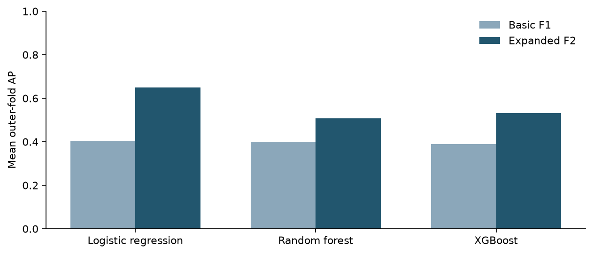
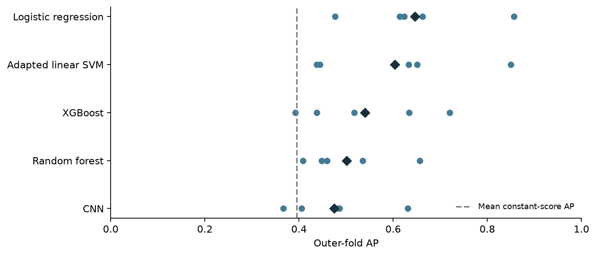
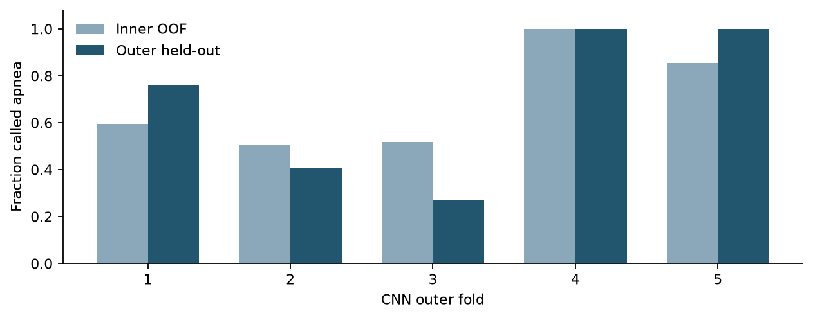
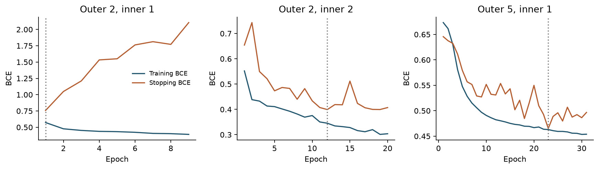
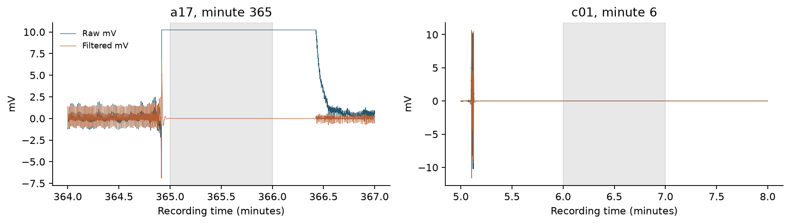

# RR interval features and a lightweight CNN for sleep apnea classification

**Final study report · November 2026**

## Abstract

This study compared ECG representations and classifiers for identifying apnea-associated one-minute annotations in the PhysioNet Apnea-ECG learning cohort. After removing one overlapping recording, the analysis included 34 recordings, 16,558 minutes and 24 literature-derived groups. Two questions were examined: whether RR variability features improve on basic cardiac summaries, and how feature-based classifiers compare with a compact waveform CNN. All methods used the same retained windows and five outer grouped folds. Hyperparameters were selected within three inner folds; operating thresholds were chosen from inner out-of-fold predictions.

Adding SDRR, RMSSD and pRR50 increased mean outer-fold average precision (AP) by 0.248 for logistic regression, 0.107 for random forest and 0.141 for XGBoost under fixed classifier settings. SDRR had the largest conditional removal effect. In the tuned comparison, logistic regression achieved the highest observed mean AP (0.646), followed by an adapted literature linear SVM (0.603), XGBoost (0.540), random forest (0.502) and the 100 Hz CNN (0.474). The constant-score reference was 0.395.

Ranking performance did not translate into reliable decisions. At the training-selected thresholds, all models had pooled specificity below 0.41; the CNN predicted every minute positive in two folds. Follow-up checks reproduced the CNN inputs, predictions, filtering and stopping decisions, while exposing poor stopping-group generalization and constant-signal intervals in the source data. The findings support the value of RR variability within this experiment, but do not establish general superiority of classical models or clinical usefulness. Unverified subject identities, prior cohort exposure and the absence of external validation limit the conclusions.

## 1. Research questions

The task was to classify existing one-minute annotations using ECG alone. It was not to diagnose a person, estimate a clinical apnea–hypopnea index, or replace respiratory measurements.

**RQ1 — Feature effectiveness:** How do different ECG-derived feature representations affect sleep apnea classification performance?

A basic representation, F1, contained mean RR, median RR and mean instantaneous heart rate. The expanded representation, F2, added SDRR, RR-based RMSSD and pRR50. Removing each added feature in turn tested its contribution conditional on the remaining inputs.

**RQ2 — Model comparison:** How do traditional feature-based models compare with a lightweight deep learning model for sleep apnea detection?

Logistic regression, random forest and XGBoost using F2 were compared with a compact 1D CNN using filtered ECG waveforms. An independently implemented adaptation of a published linear SVM method provided a literature-derived comparator. This was a comparison of complete input-and-model pipelines: it did not isolate classifier choice from representation.

## 2. Data and signal preparation

### 2.1 Cohort and reference labels

The source was the [PhysioNet Apnea-ECG database, version 1.0.0](https://physionet.org/content/apnea-ecg/1.0.0/). Its ECG is sampled at 100 Hz, and the reference annotations were assigned by experts using simultaneously recorded respiratory and related signals. The database documents that `c05` overlaps `c06`; `c05` was excluded. Only the learning cohort was analyzed. The separate challenge test cohort was not used as external validation.

| Cohort characteristic | Value |
| --- | ---: |
| Retained recordings | 34 |
| Literature-derived groups | 24 |
| Complete one-minute windows | 16,558 |
| Apnea-associated windows | 6,508 (39.3%) |
| Non-apnea windows | 10,050 (60.7%) |
| Windows with at least one quality flag | 623 (3.76%) |
| Windows with missing F1/F2 predictors | 115 (0.69%) |

Each window contained 6,000 samples. Source A/N labels at the corresponding minute boundary were retained; the positive label includes apnea/hypopnea annotations. These labels should not be interpreted as a precise event-onset or event-duration target.

The grouping used a published record-to-subject mapping, documented in [Notebook 01](../notebooks/01_data_inspection.ipynb) and attributed to Yeh et al. [2]. Original subject identifiers were unavailable. Group separation was enforced computationally, but verified patient independence cannot be claimed.

### 2.2 Filtering, beats and quality policy

Source files were checked against recorded checksums. ECG was filtered within each full recording using a 0.5–40 Hz Butterworth bandpass, design order four, in second-order sections with forward/backward zero-phase filtering. This is retrospective processing: it uses future samples within a recording and is not a causal streaming pipeline.

R peaks were detected with WFDB GQRS in blocks with surrounding context, then locally aligned and deduplicated. Detected RR intervals were accepted between 0.3 and 2.0 seconds. Features used intervals whose endpoints lay within the same minute. Differences between successive intervals preserved original adjacency; rejecting an interval did not join its neighbors. No ectopic-beat classification or RR interpolation was performed.

Complete finite windows were retained even when flagged for flat signal, low amplitude, too few usable intervals or suspect RR intervals. Flags were diagnostic metadata, not predictors. Missing features were imputed within the fitting partition. This policy kept the cohort identical across representations and avoided silently restricting the comparison to cleaner signals.

### 2.3 Feature definitions

| Representation | Feature | Definition |
| --- | --- | --- |
| F1 | Mean RR | Mean accepted interval, in ms |
| F1 | Median RR | Median accepted interval, in ms |
| F1 | Mean instantaneous heart rate | Mean of 60,000 divided by each accepted RR interval, in bpm |
| F2 addition | SDRR | Sample standard deviation of accepted RR intervals, in ms |
| F2 addition | RR-based RMSSD | Root mean square of valid adjacent interval differences, in ms |
| F2 addition | pRR50 | Percentage of valid adjacent differences with absolute magnitude greater than 50 ms |

At least 20 accepted intervals were required; RMSSD and pRR50 also required ten valid adjacent pairs. Undefined values remained missing until fold-local imputation. These are detected RR statistics, not audited normal-to-normal measurements. Their predictive value does not validate a physiological interpretation of one-minute HRV.

## 3. Evaluation design

### 3.1 Grouped nested evaluation

Five outer folds held each literature-derived group out once. Within each outer training partition, three inner grouped folds were shared across models. Imputation, scaling and fitting-dependent class weights used only the current training partition. Identifiers, groups, quality flags and labels were excluded from predictors.

The two questions used different controls:

- **RQ1:** classifier settings were fixed across all five feature configurations. Each model and its preprocessing were refitted for every configuration. This kept feature effects separate from hyperparameter changes.
- **RQ2:** each of the five pipelines received 24 frozen candidate configurations per outer fold. Logistic regression and the linear SVM used grids; tree models used seeded sampled configurations. The CNN architecture was fixed, with its training settings searched. Selection maximized mean inner-fold AP.

For every selected pipeline, a threshold maximized F1-score on inner out-of-fold predictions, with the lowest threshold breaking ties. That threshold was then applied unchanged to the outer held-out groups. Outer labels did not select hyperparameters, epochs or thresholds. The evaluation protocol, candidate lists, input hashes and source versions were frozen before these outer evaluations.

### 3.2 Models and CNN training

Classical models used median imputation; logistic regression and the SVM additionally used standard scaling. The literature comparator adapted Almazaydeh et al. [3] using 11 local RR statistics and a linear SVM. Its windows were 60 seconds, its beat extraction followed this project's common policy, and recording-wide summaries were omitted. It was an adaptation, not an exact reproduction or execution of author code. Expert reference labels were not a human-performance baseline.

The CNN had 3,009 trainable parameters: three convolutional blocks, ReLU activations, two max-pooling layers, global average pooling and a linear output. Inputs were filtered 100 Hz minutes, standardized within each minute using a 0.001 standard-deviation floor, clipped to ±8, and stored as float32. Training used Adam and binary cross-entropy with logits; inference applied sigmoid once.

CNN epochs were calibrated using a stopping subset drawn only from inner training groups. Unweighted stopping BCE used patience eight, minimum improvement 0.0001 and a maximum of 60 epochs. Each candidate was then freshly initialized and refitted on all inner-training groups for its selected epoch count before inner validation. The outer refit used the rounded median of the selected inner epoch counts. This separated stopping feedback from both inner validation and outer evaluation.

Primary results used seed 67. Random forest, XGBoost and CNN were also refitted with seeds 167 and 267, retaining selected settings and epoch schedules. These runs measured refit sensitivity, not independent cohort replications; no seed was selected as the winner and predictions were not ensembled.

### 3.3 Metrics and uncertainty

The primary outcome was the **arithmetic mean of five outer-fold AP scores**, using scikit-learn's average-precision definition. AP summarizes precision across recall levels; it is not classification accuracy. A constant scorer's mean fold AP was 0.395, reflecting mean fold prevalence.

Pooled outer predictions supplied secondary AP, ROC-AUC, F1-score, sensitivity and specificity. Pooled scores combine outputs from five fitted models, so pooled AP need not equal mean fold AP. Thresholded metrics used each fold's own inner-selected threshold.

Whole groups were resampled jointly across methods for 2,000 paired bootstrap draws. The reported percentile intervals describe differences in **pooled AP conditional on the fitted predictions**. They do not cover all training or tuning uncertainty and are not intervals for the primary mean fold AP. No minute-level significance test was used. Fold standard deviations are descriptive.

## 4. Results for RQ1

### 4.1 RR variability improved the expanded representation

| Fixed-setting classifier | Basic F1 AP | Expanded F2 AP | F2 − F1 |
| --- | ---: | ---: | ---: |
| Logistic regression | 0.401 | 0.650 | +0.248 |
| Random forest | 0.400 | 0.507 | +0.107 |
| XGBoost | 0.390 | 0.531 | +0.141 |

Values are means across matched outer folds; differences are calculated before rounding. The basic summaries alone were close to the constant-score reference. Adding the three variability features improved mean AP for all classifiers. The gain occurred in all five folds for logistic regression and four of five for each tree model. It was not uniform across groups or models.

### 4.2 SDRR had the largest conditional removal effect

| Fixed-setting classifier | Full F2 | Without SDRR | Without RMSSD | Without pRR50 |
| --- | ---: | ---: | ---: | ---: |
| Logistic regression | 0.650 | 0.357 | 0.521 | 0.668 |
| Random forest | 0.507 | 0.355 | 0.489 | 0.519 |
| XGBoost | 0.531 | 0.363 | 0.503 | 0.545 |

Removing SDRR reduced AP by 0.293, 0.152 and 0.168, respectively. Removing RMSSD also reduced mean AP, although its effect was smaller in the tree models. Both removals reduced AP in every fold for all three classifiers.

Removing pRR50 modestly increased mean AP for all three models, by 0.012–0.018. The fold-level changes were mixed, so this is evidence of limited incremental value in this representation, not a consistent benefit from removing it everywhere. The prespecified F2 representation remained the basis of RQ2.

**Answer to RQ1:** RR variability improved classification relative to basic interval and heart-rate summaries in this experiment. SDRR contributed most among the tested conditional removals; RMSSD added useful information, while pRR50 showed little additional benefit. These results describe predictive dependence within the tested feature sets, not physiological causation or universal feature importance.

## 5. Results for RQ2

### 5.1 Logistic regression led the tuned comparison

| Tuned pipeline | Mean fold AP | Fold SD | Pooled AP | Pooled ROC-AUC |
| --- | ---: | ---: | ---: | ---: |
| Logistic regression, F2 | **0.646** | 0.137 | **0.594** | **0.708** |
| Adapted literature linear SVM | 0.603 | 0.171 | 0.560 | 0.684 |
| XGBoost, F2 | 0.540 | 0.136 | 0.508 | 0.630 |
| Random forest, F2 | 0.502 | 0.098 | 0.499 | 0.633 |
| Lightweight CNN, 100 Hz | 0.474 | 0.101 | 0.432 | 0.548 |
| Constant-score reference | 0.395 | 0.053 | 0.393 | 0.500 |

Logistic regression exceeded the CNN by 0.172 mean AP and XGBoost by 0.106. The adapted SVM was a substantial competitor, exceeding both tree models and the CNN. Its score should not be compared directly with the source paper's headline accuracy because the cohort, windows and evaluation differ.

The bounded searches did not produce consistent gains over fixed F2 settings: AP changed from 0.650 to 0.646 for logistic regression, 0.507 to 0.502 for random forest, and 0.531 to 0.540 for XGBoost. Better inner selection does not guarantee better held-out performance. Both analyses are retained rather than choosing whichever scored better on the outer data.

### 5.2 Performance depended strongly on the held-out groups

| Pipeline | Fold 1 AP | Fold 2 AP | Fold 3 AP | Fold 4 AP | Fold 5 AP |
| --- | ---: | ---: | ---: | ---: | ---: |
| Logistic regression | 0.662 | 0.476 | 0.856 | 0.614 | 0.623 |
| Adapted linear SVM | 0.633 | 0.438 | 0.849 | 0.651 | 0.444 |
| XGBoost | 0.633 | 0.518 | 0.720 | 0.437 | 0.392 |
| Random forest | 0.459 | 0.535 | 0.657 | 0.448 | 0.408 |
| CNN | 0.366 | 0.486 | 0.406 | 0.631 | 0.483 |

The CNN led fold 4 among the three F2 classical models, despite its lower overall mean. Logistic regression ranged from 0.476 to 0.856 AP. Fold prevalences also differed, from 0.319 to 0.468, which matters when interpreting AP. The spread is not solely an estimate of algorithm randomness, and overlapping training folds are not independent experiments.

Repeat-seed mean AP was 0.502/0.503/0.502 for random forest, 0.540/0.540/0.541 for XGBoost and 0.474/0.487/0.476 for the CNN. Seed changes did not reverse the main ordering among these pipelines, but small mean seed variation does not resolve uncertainty about unseen groups.

### 5.3 The uncertainty supports a narrower conclusion than the mean ranking

| Pooled AP difference: XGBoost minus comparator | Estimate | Conditional 95% interval |
| --- | ---: | --- |
| Logistic regression | −0.086 | −0.164 to −0.008 |
| Adapted linear SVM | −0.052 | −0.133 to +0.037 |
| Random forest | +0.009 | −0.023 to +0.063 |
| CNN | +0.076 | −0.074 to +0.236 |

All comparisons had 2,000 valid draws. The LR comparison offers conditional exploratory evidence favoring LR over XGBoost. The other intervals cross zero. These intervals are not adjusted for multiple comparisons, and direct LR–CNN or LR–SVM intervals were not part of the exported comparison set. The mean ranking should not be described as proof that every adjacent pair differs reliably.

**Answer to RQ2:** logistic regression achieved the highest observed mean AP among the tested pipelines, and the adapted literature SVM was also competitive. The compact CNN did not demonstrate an advantage. The evidence does not establish that classical models generally outperform deep learning, nor that this CNN result represents the best attainable waveform model.

## 6. Ranking did not produce reliable operating points

| Pipeline | Pooled sensitivity | Pooled specificity | Pooled F1-score |
| --- | ---: | ---: | ---: |
| Logistic regression | 0.760 | 0.406 | 0.568 |
| Adapted linear SVM | 0.766 | 0.398 | 0.569 |
| XGBoost | 0.763 | 0.309 | 0.539 |
| Random forest | 0.743 | 0.347 | 0.540 |
| CNN | 0.712 | 0.345 | 0.523 |
| Always predict apnea | 1.000 | 0.000 | 0.564 |

The always-positive reference is important: its pooled F1-score was close to those of logistic regression and the SVM, and above those of the other models. Useful ranking signal therefore did not translate into a persuasive operating point. The selected models exchanged many false alarms for sensitivity.

The CNN predicted every held-out minute positive in folds 4 and 5. Random forest and XGBoost also did so in fold 1; XGBoost specificity in fold 2 was only 0.0004. A plausible-looking F1-score can conceal zero specificity.

The threshold audit showed that the problem began before outer evaluation:

| CNN fold | Inner-selected threshold | Inner positive rate | Outer positive rate |
| --- | ---: | ---: | ---: |
| 1 | 0.425 | 59.5% | 75.8% |
| 2 | 0.287 | 50.8% | 40.7% |
| 3 | 0.369 | 51.7% | 26.7% |
| 4 | 0.247 | 99.98% | 100% |
| 5 | 0.240 | 85.5% | 100% |

In fold 4, inner median scores for negative and positive minutes were 0.378 and 0.374, showing little useful separation. Maximizing F1 on those scores already favored calling almost everything positive. F1 maximization imposed no minimum specificity.

Other folds showed score-scale changes: in fold 1, the negative median rose from 0.378 on inner out-of-fold predictions to 0.629 on outer predictions. An inner threshold combines scores from several fitted models and may not match the scale of the final refit. Weak separation, permissive threshold selection and score-distribution changes all contributed to the observed pattern; the audit did not identify a single cause.

## 7. CNN training and preprocessing audit

### 7.1 The implementation checks reproduced the saved outputs

All 16,558 cached CNN minutes matched independently reconstructed source preprocessing exactly. All 15 exported CNNs—five folds and three seeds—reproduced their saved outer scores with zero maximum absolute difference. Independent threshold calculations agreed with the saved primary thresholds across all five pipelines. These checks found no cache-ordering or inference-conversion error; they do not prove that every upstream decision was appropriate.

### 7.2 Short refits reflected unstable stopping-group performance

Seven of the 15 selected CNN calibration runs chose epoch 1. Other runs selected as late as epoch 23; the final outer schedules were 1, 1, 3, 2 and 1 epochs. The stopping decisions and refit lengths matched the specified rule.

Training loss decreased in every selected calibration run, while final stopping loss exceeded its selected minimum. For example, in fold 2 / inner 1, training BCE fell from 0.573 to 0.391 as stopping BCE rose from 0.758 to 2.106. Another inner split in the same fold improved until epoch 12. This is consistent with poor generalization to some stopping groups, not a patience-counter error.

These trajectories do not show that simply training longer would help. More observed epochs often worsened stopping BCE. BCE and AP measure different properties, but per-epoch stopping AP was not saved, so an objective mismatch remains a hypothesis. The median epoch rule also compresses heterogeneous histories into very short refits.

The fixed architecture offers another limitation: its local receptive field before global pooling spans 113 input samples, about 1.13 seconds at 100 Hz. It aggregates local responses across the minute without explicitly modeling long interval sequences. Whether that restriction explains its weak performance needs a separate experiment.

### 7.3 Near-flat minutes originated in the raw recordings

Seventeen filtered minutes fell below the normalization floor. Each contained exactly one digital value in the original WFDB recording: sixteen were constant at zero, and one at 2047 digital units. Saved raw physical samples matched original decoding. Independently reconstructed whole-record filtering matched the saved arrays exactly for all seven affected recordings, and the corresponding source annotations matched their retained labels.

All 17 minutes were already flagged as flat and low-amplitude. They were retained under the common quality policy, not introduced by CNN caching. Removing a constant baseline with a bandpass filter is expected behavior; these checks did not show that filtering erased valid ECG in those intervals. Their physical acquisition cause is unverified.

These minutes account for roughly 0.10% of the cohort. They establish a source-quality issue, but not an explanation for the overall performance gap. No windows were removed and no replacement scores were calculated after this finding.

## 8. Discussion and limitations

The clearest finding is that interval variability mattered more than basic cardiac level summaries. Within the fixed ablation, SDRR and RMSSD added information that all three classifiers used. A six-feature linear model then led the tuned comparison. This favors a simple model as the starting point for further development on this task, rather than assuming a more complex estimator will generalize better.

The practical result is less favorable. Even the leading model combined sensitivity of 0.760 with specificity of 0.406. Fold differences, permissive thresholds and unstable CNN stopping histories show that the remaining problem is not adequately described by a single average score.

Several limits govern interpretation:

1. **The independent sample is small and uncertain.** The 16,558 minutes are correlated within recordings. There are only 24 literature-derived groups, and original identities have not been verified. Grouped evaluation reduces a known form of overlap but cannot establish patient independence.
2. **This is exploratory internal evaluation.** The cohort had been examined before the protocol was frozen. Nested splitting controls selection within this run; it does not make the exposed cohort an untouched confirmatory test.
3. **There is no external validation.** Performance on another collection, acquisition setup or clinical population is unknown. Source annotations are a classification reference, not evidence of diagnostic utility.
4. **Signal and feature quality remain imperfect.** Constant intervals were present, beat detection was not audited against expert peaks throughout the cohort, and detected RR features are not verified NN measures. Retrospective zero-phase filtering also limits streaming claims.
5. **The model comparison has a defined scope.** It covers one compact CNN architecture, six-feature classical pipelines, an adapted local-RR SVM and finite searches. It does not isolate architecture from representation or establish a model-family ceiling. The SVM is not an exact reproduction or human baseline.
6. **Uncertainty is only partly measured.** Bootstrap intervals condition on saved predictions and omit full refitting/tuning variation. Repeated seeds add no independent subjects. Large fold variation remains relevant despite stable mean seed scores.
7. **Practical deployment was not assessed.** These thresholds were not selected for a specified clinical operating requirement, calibration was not established, and complete preprocessing-to-prediction serving cost was not benchmarked. Parameter count alone is not a deployment evaluation.

A useful next study would define signal-quality handling and operating-point requirements in advance, record per-epoch ranking metrics alongside loss, and evaluate a small set of training policies on development data. Any model changes prompted by these outer results remain exploratory on this cohort. Stronger evidence requires independent data with verified identities.

## 9. Conclusion

**RQ1:** adding RR variability improved mean AP across all three fixed-setting classifiers. SDRR had the strongest conditional contribution, RMSSD added information, and pRR50 provided little incremental value in the tested representation.

**RQ2:** logistic regression achieved the highest observed mean AP, followed by the adapted literature SVM. The compact 100 Hz CNN did not improve on the feature-based pipelines. The ranking does not establish universal model superiority, and the selected operating points were unreliable across held-out groups.

The study provides a reproducible comparison and a documented account of where the methods failed. Its strongest result is evidence for RR variability in this setting; its central limitation is uncertain generalization beyond the evaluated groups.

## References

1. Penzel T, Moody GB, Mark RG, Goldberger AL, Peter JH. *The Apnea-ECG Database.* Computers in Cardiology. 2000;27:255–258. [Dataset version 1.0.0 and source citation](https://physionet.org/content/apnea-ecg/1.0.0/), DOI [10.13026/C23W2R](https://doi.org/10.13026/C23W2R). Data are distributed under the Open Data Commons Attribution License v1.0.
2. Yeh CY, Chang HY, Hu JY, Lin CC. *Contribution of Different Subbands of ECG in Sleep Apnea Detection Evaluated Using Filter Bank Decomposition and a Convolutional Neural Network.* Sensors. 2022;22(2):510. [doi:10.3390/s22020510](https://doi.org/10.3390/s22020510). Table 1 is the recorded grouping source; local assignments remain explicit in Notebook 01.
3. Almazaydeh L, Elleithy K, Faezipour M. *Obstructive sleep apnea detection using SVM-based classification of ECG signal features.* EMBC. 2012:4938–4941. [doi:10.1109/EMBC.2012.6347100](https://doi.org/10.1109/EMBC.2012.6347100). Source fidelity and adaptations are documented in the [baseline register](literature-baselines.md).
4. Pollard T, Moody BE, Lehman L, et al. *PhysioNet as a global platform for biomedical research.* Nature Health. 2026;1:792–795. [doi:10.1038/s44360-026-00096-z](https://doi.org/10.1038/s44360-026-00096-z). Platform citation requested by the dataset provider.

## Reproducibility appendix

This showcase contains the primary outer-fold models and all reported prediction/metric tables. The original 140-file export manifest is preserved in `provenance/original-results-manifest.json`; the bundled results manifest explicitly lists the retained subset. Extra seed and ablation model binaries are omitted, while their predictions and results remain included. See [reproduction instructions](../REPRODUCING.md) for the optional prepared-waveform download and notebook execution order.

Analysis is implemented in ordered notebooks. [Notebook 00](../notebooks/00_prepare_data.ipynb) prepares signals; [01](../notebooks/01_data_inspection.ipynb) documents groups; [02](../notebooks/02_feature_ablation.ipynb) defines the fixed feature experiment. [05–08](../notebooks/05_evaluation_protocol.ipynb) define and execute the frozen nested evaluation. [09](../notebooks/09_nested_results.ipynb) checks results, [10](../notebooks/10_cnn_implementation_audit.ipynb) audits inference and thresholds, and [11](../notebooks/11_cnn_curves_and_raw_signals.ipynb) traces selected learning curves and source signals. [Notebook 12](../notebooks/12_final_report.ipynb) verifies the reported tables and renders the illustrated report. Use the project Python environment (`uv sync --locked`) and execute notebooks with the project kernel.

The evaluated run is `real-20261109-v1` under `data/processed/portfolio-v2/plan001-real-20261108/full/`. Its 29 configurations include fixed ablations, tuned pipelines, repeat seeds and trivial references. Every configuration contains one outer prediction for each cohort window. All 24 candidates per pipeline and outer fold are accounted for. The complete result export contains 140 hashed artifacts; no fitting failures were recorded. SVC deprecation warnings were recorded without changing the frozen implementation.

Source notebooks contain no large outputs. Data, checkpoints and executed reports remain under ignored `data/` and `reports/`. The tracked report retains the tables needed to read its conclusions without those files; Notebook 12 produces a standalone HTML copy with embedded figures. That HTML can be shared without hosting the recordings or checkpoints.

Freeze identity: `1765caa330e2136b1f16f61828fae0a568bcc36b0730bd3b2cfd9b3d7e2f1363`.

Detailed evidence: [nested metrics and uncertainty](portfolio-nested-results.md), [implementation audit](cnn-implementation-audit.md), [selected curves and raw-signal audit](cnn-training-and-raw-signal-audit.md). These supporting files preserve the audit detail behind the report's conclusions.
